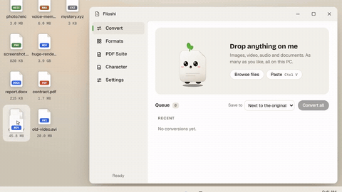
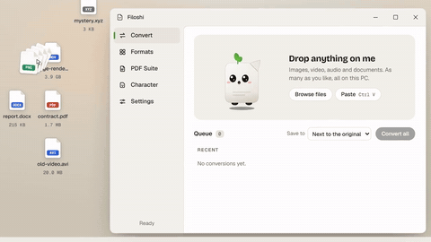
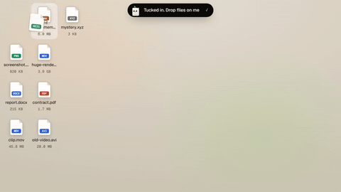

  <a href="https://filoshi.com">
    <picture>
      <source media="(prefers-color-scheme: dark)" srcset="assets/filoshi-logo-horizontal-dark.svg">
      
    </picture>
  </a>

<strong>The file converter that works on your PC.</strong> Drop anything on me.

  <a href="https://filoshi.com">Website</a> ·
  <a href="https://filoshi.com/#pricing"><strong>Get Filoshi — $29</strong></a> ·
  <a href="https://filoshi.com/formats">Formats</a> ·
  <a href="https://filoshi.com/blog">Blog</a> ·
  <a href="https://github.com/OuterSpacee/Filoshi-Support/issues/new/choose">Report an issue</a> ·
  <a href="https://github.com/OuterSpacee/Filoshi-Support/discussions">Discussions</a>

---

Filoshi is a small desktop app with a big appetite. Drag a file onto the window and the little character who lives there eats it, then hands back the same file in the format you picked.

- **Your files never leave your PC.** The conversion engines ship inside the app. There is nothing to upload and no account to make.
- **It converts between the families we test.** 1,841 conversions passed our automated test matrix with 0 failures: video (896), audio (342), images (420), documents (123) and archives (60).
- **You pay once.** $29, no subscription. Every 2.x update is included.

## See it in action

   
  <em>Drop a file and Filoshi eats it. The new file appears next to the original.</em> 

   
  <em>Drop a whole pile. Each file shows its own progress and result.</em> 

   
  <em>Close the window and Filoshi becomes a small pill at the top of the screen. Drop a file on it, pick a format, drag the result out.</em> 

## What Filoshi does

Drag a file onto the window, pick a format and press Convert. The new file appears next to the original, or in a folder you choose. The original is never changed.

The engines inside the app are FFmpeg, ImageMagick, Pandoc, PDFium, pdfcpu and 7-Zip. Filoshi runs on Windows 10 and 11.

The app lists 2,501 conversions from 152 input formats (counts from the test report of 2026-10-24, Windows 11):

| Family | Tested | Needs an add-on | Not yet tested | Examples |
|---|---:|---:|---:|---|
| Video | 896 | 0 | 0 | MP4, MOV, MKV, AVI, WebM |
| Audio | 342 | 0 | 36 | MP3, WAV, FLAC, OGG, M4A |
| Images | 420 | 0 | 342 | HEIC, RAW, PSD, WebP, AVIF, PNG, JPG |
| Documents | 123 | 71 | 8 | DOCX, PDF, EPUB, Markdown, HTML |
| Archives | 60 | 0 | 42 | ZIP, 7Z, TAR, RAR, ISO |
| 3D and CAD | 0 | 144 | 0 | STEP, STL, OBJ, GLB, DXF (with FreeCAD) |
| Email | 0 | 5 | 0 | EML (with LibreOffice) |
| Fonts | 0 | 0 | 12 | TTF, OTF, WOFF |

That is 1,841 tested, 220 that need a free add-on and 440 that are listed but not yet covered by a test file. The full, searchable list is on [filoshi.com/formats](https://filoshi.com/formats). The table groups formats the way that page does (GIF counts as an image).

Filoshi 2.0 also brings:

- **Many files at once.** Drop forty files and they go down in one gulp.
- **The file viewer.** Look before you convert: crop, rotate, resize and adjust pictures, trim video and audio, change resolution, frame rate, speed or volume, and pick PDF pages.
- **The PDF Suite.** Organize, merge, split, compress, protect, watermark, number and sign PDFs, and add text, pictures, highlights or drawings to a page.
- **The island.** A small pill at the top of the screen. Ctrl+Alt+F opens it.
- **The taskbar buddy** (optional). Filoshi walks along the taskbar and perches on the window.
- **Characters and a wardrobe.** Seven characters and seventeen outfits. Sounds stay off unless you turn them on.

Want to try before you buy? The home page at [filoshi.com](https://filoshi.com) converts one file in your browser without uploading it: photos up to 50 MB, audio up to 100 MB and video up to 200 MB. The desktop app does everything else.

## Install

| Platform | Version | Notes |
|---|---|---|
| Windows 10 and 11 (64-bit) | **2.0.0** (released 2026-10-27) | Everything described on this page |
| macOS | 1.0.36 | The earlier version, same license key. A Mac version of 2.0 comes later as a free update with the same key; no date yet |
| Linux | 1.0.36 | The earlier version, same license key |

1. Buy a license at [filoshi.com](https://filoshi.com/#pricing). The key arrives by email.
2. Go to [filoshi.com/download](https://filoshi.com/download) and enter your key to get the installer.
3. Run it. It installs for your user only and needs no admin rights.
4. Paste your key once in the app. After that it works offline.

The Windows installer is not code-signed yet, so Windows SmartScreen may say "Windows protected your PC" the first time. Choose **More info**, then **Run anyway**.

Two engines are too large to bundle, so they are optional downloads. Get them only if you need them:

- **LibreOffice** for Office documents (Word, Excel, PowerPoint, OpenDocument).
- **FreeCAD** for 3D models and CAD files.

The app downloads each one once, inside the app, the first time you need it. After that they run offline too.

## Pricing and refunds

**$29, once.** One payment, no subscription, and every 2.x update is included. A later major version may be sold separately. The version you own keeps working. Payments are handled by Polar, and the license key arrives by email after checkout.

[**Get Filoshi — $29**](https://filoshi.com/#pricing)

**Refunds.** All sales are final. If Filoshi won't install, won't start, or can't do a conversion the site says it does, and we can't fix it with you, we refund you in full within 30 days of your purchase. A refund turns off the license key. This does not limit any rights you have under the law where you live. Details: [filoshi.com/refund](https://filoshi.com/refund).

## Licensing

- **The Filoshi app is proprietary software.** Its source code is not published. You get a personal, non-transferable license to use it on your own devices. Your key can be active on a limited number of PCs at once, and each activation is tied to one PC. To move Filoshi, use Settings → License → Deactivate this PC on the old one. See the [terms of service](https://filoshi.com/terms).
- **Codecs and patents.** Which video and audio formats may be covered by patents is explained at [filoshi.com/codec-licensing](https://filoshi.com/codec-licensing).
- **Open-source components.** Filoshi bundles open-source engines that keep their own licenses: FFmpeg (GPL 3.0), ImageMagick (ImageMagick License), Pandoc (GPL 2.0 or later), 7-Zip (LGPL 2.1 or later, BSD 3-clause, unRAR restriction), PDFium (BSD 3-clause and Apache 2.0) and pdfcpu (Apache 2.0). The optional add-ons are LibreOffice (MPL 2.0, much of it also LGPL 3.0 or later) and FreeCAD (LGPL 2.0 or later). The full list, with versions and where to get the source, is at [filoshi.com/open-source](https://filoshi.com/open-source).
- **This repository.** The documents here (this README, the support guides and the issue forms) are licensed under [CC BY 4.0](LICENSE). The Filoshi name, logo and characters are not covered by it.

## Getting help

Start with the checklist in [SUPPORT.md](SUPPORT.md). It solves most problems: SmartScreen, macOS Gatekeeper, missing add-ons and files too big for the browser try.

Still stuck? [Open an issue](https://github.com/OuterSpacee/Filoshi-Support/issues/new/choose) and pick the form that fits:

- **Bug report**: the app crashes, freezes or looks wrong.
- **Conversion failed**: a conversion gives an error, a broken file or a wrong result.
- **Format request**: a format Filoshi doesn't list yet.
- **Feature request**: an idea for the app.
- **Website issue**: something wrong on filoshi.com.

Have a question? Ask in [Discussions](https://github.com/OuterSpacee/Filoshi-Support/discussions).

Anything about a purchase, a license key or a refund: email [support@filoshi.com](mailto:support@filoshi.com). Never post a license key, order number or email receipt in a public issue.

Filoshi is made by one independent developer. We aim to reply to email within 2 business days and to label issues within a few business days. These are goals, not guarantees.

Found a security problem? Please don't open a public issue. See [SECURITY.md](SECURITY.md).

## Privacy

Your files never leave your computer. There is no account. The app has no analytics, no telemetry and no advertising. It goes online for only three things: a background license check, an update check at most once a week when it starts (you can turn this off in Settings), and downloading an add-on when you ask for it.

The website is different. filoshi.com uses analytics (PostHog) to count visits, and checkout is handled by Polar. Details: [filoshi.com/privacy](https://filoshi.com/privacy).

## Projects that make Filoshi possible

Filoshi stands on the work of people who share theirs. Thank you to:

- [FFmpeg](https://ffmpeg.org) for video and audio
- [ImageMagick](https://imagemagick.org) for images
- [Pandoc](https://pandoc.org) for documents
- [7-Zip](https://www.7-zip.org) for archives
- [PDFium](https://pdfium.googlesource.com/pdfium/) for PDFs
- [pdfcpu](https://github.com/pdfcpu/pdfcpu) for PDF tools
- [LibreOffice](https://www.libreoffice.org) for Office documents (optional add-on)
- [FreeCAD](https://www.freecad.org) for 3D models and CAD (optional add-on)
- [Bricolage Grotesque](https://github.com/ateliertriay/bricolage) and [Geist](https://github.com/vercel/geist-font) for the fonts

---

Filoshi is made with ❤️ by Ismail.

